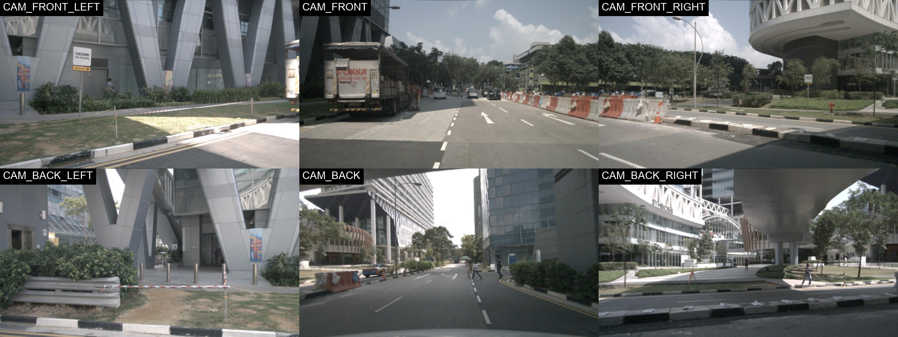
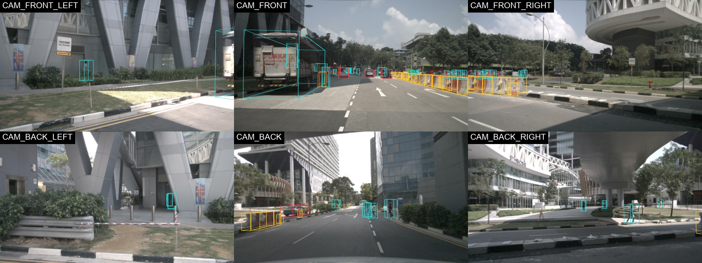
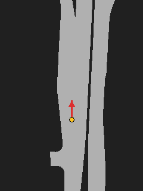
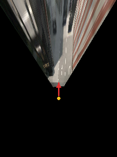
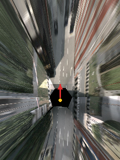

# SurroundBEV

A camera-only Bird's-Eye-View perception system built using the nuScenes autonomous-driving dataset.

SurroundBEV is an end-to-end perception engineering project covering multi-camera data ingestion, calibration-aware geometry, Bird's-Eye-View target generation, perception model development, robustness evaluation, failure analysis, and deployment optimization.

> **Project status:** In active development  
> **Last completed milestone:** Milestone 3 — geometry-only camera-to-BEV projection

---

## Project Objective

The objective of SurroundBEV is to develop a camera-only perception pipeline that transforms synchronized surround-view camera images into an ego-centric Bird's-Eye-View representation for autonomous-driving applications.

The project is being developed incrementally:

```text
nuScenes surround-camera data
            ↓
Calibration-aware preprocessing
            ↓
Camera-to-BEV transformation
            ↓
BEV segmentation and 3D detection
            ↓
Scenario-based robustness evaluation
            ↓
Failure mining and targeted retraining
            ↓
Training and deployment optimization
```

---

## Current Capabilities

SurroundBEV currently supports:

**Data ingestion and inspection**

- Loading synchronized images from all six nuScenes cameras
- Selecting samples through a configurable sample index
- Reading scene, sample, sensor, and camera metadata
- Creating labeled six-camera surround-view mosaics
- Retrieving camera calibration and ego-pose information

**Calibration-aware geometry**

- Loading 3D ground-truth annotations for each camera
- Projecting 3D bounding boxes into camera images
- Filtering projected geometry using camera-relative depth
- Drawing the 12 edges of visible 3D bounding boxes
- Generating multi-camera geometry-validation mosaics

**Ego-centric BEV targets**

- Resolving the semantic-map location from the sample's log
- Loading drivable-area polygons for the ego window
- Transforming global map polygons into the ego frame
- Rasterizing a binary drivable-area mask on a metric grid
- Writing the raw `uint8` mask alongside a rendered visualization

**Geometry-only camera-to-BEV projection**

- Intersecting camera rays with the ego ground plane
- Compensating for the timestamp offset between each camera and the BEV reference pose
- Projecting a single camera into the BEV grid (inverse perspective mapping)
- Stitching all six cameras into one ego-centric BEV image
- Validating configuration, projection, rasterization, and visualization behavior through automated tests

---

## Dataset

The project currently uses the **nuScenes `v1.0-mini` dataset**.

The dataset is stored outside this Git repository and is not included with the source code.

Expected local dataset structure:

```text
datasets/
└── v1.0-mini/
    ├── LICENSE
    ├── maps/
    │   ├── expansion/
    │   │   ├── boston-seaport.json
    │   │   ├── singapore-hollandvillage.json
    │   │   ├── singapore-onenorth.json
    │   │   └── singapore-queenstown.json
    │   └── *.png
    ├── samples/
    ├── sweeps/
    └── v1.0-mini/
```

### Map expansion

Milestones 0, 1, and 3 need only the base `v1.0-mini` archive.

**Milestone 2 additionally requires the nuScenes map expansion pack**, which is a
separate download from the nuScenes website. Extract it so the per-location JSON
files land in `maps/expansion/`. Without them,
`scripts/generate_bev_target.py` exits with:

```text
Error: nuScenes map expansion not found: <dataset_root>/maps/expansion/<location>.json
```

The dataset path is provided through `configs/mini.yaml`. No local dataset path is hardcoded in the Python implementation, and no map name is hardcoded either — the location is read from the sample's log record.

---

## Camera Arrangement

SurroundBEV uses six synchronized surround-view cameras in the following layout:

```text
CAM_FRONT_LEFT  | CAM_FRONT | CAM_FRONT_RIGHT
CAM_BACK_LEFT   | CAM_BACK  | CAM_BACK_RIGHT
```

This explicit ordering is shared by the data loader, visualization pipeline, tests, and generated mosaics.

---

## Completed Milestones

### Milestone 0: Six-Camera Sample Inspection

Milestone 0 established the multi-camera data-ingestion and visualization foundation.

The implementation:

- Loads a nuScenes sample using a configurable sample index
- Retrieves all six synchronized camera images
- Preserves an explicit and validated camera ordering
- Reports the sample token, scene name, timestamp, and image dimensions
- Preserves camera-image aspect ratios
- Generates a labeled 2-by-3 surround-view mosaic

Run:

```bash
python scripts/inspect_sample.py --config configs/mini.yaml
```

Expected output:

```text
outputs/sample_mosaic.jpg
```

#### Six-Camera Mosaic



---

### Milestone 1: Calibration-Aware 3D Box Projection

Milestone 1 introduced camera geometry and 3D annotation projection.

The implementation:

- Retrieves nuScenes ground-truth 3D boxes for each camera
- Uses calibrated sensor and ego-pose metadata
- Represents boxes in the corresponding camera coordinate frame
- Filters geometry based on configurable minimum camera depth
- Projects 3D box corners through the camera intrinsic matrix
- Draws the 12 edges of each visible 3D bounding box
- Optionally displays object-category labels
- Reports the number of visible boxes for every camera
- Produces an annotated six-camera mosaic

Run:

```bash
python scripts/project_boxes.py --config configs/mini.yaml
```

Expected output:

```text
outputs/sample_boxes_mosaic.jpg
```

#### Calibration-Aware 3D Projection



---

### Milestone 2: Ego-Centric BEV Target Generation

Milestone 2 produced the first Bird's-Eye-View training target.

The implementation:

- Resolves the semantic-map location through `sample → scene → log → location`
- Anchors the BEV window on the `LIDAR_TOP` keyframe ego pose
- Computes the global axis-aligned bounds that cover the rotated ego window
- Loads drivable-area polygons that intersect those bounds
- Transforms global polygons into the ego frame using the planar ego heading
- Rasterizes a binary mask by testing each cell center against the polygons
- Excludes polygon holes from the drivable class
- Writes the raw `uint8` mask as `.npy` and a rendered PNG beside it

The raw mask is the training target and contains only `0` and `1`. The ego marker
and heading arrow exist only on the visualization copy.

Run:

```bash
python scripts/generate_bev_target.py --config configs/mini.yaml
```

Expected outputs:

```text
outputs/sample_bev_target.npy
outputs/sample_bev_target.png
```

#### Drivable-Area BEV Target



---

### Milestone 3: Geometry-Only Camera-to-BEV Projection

Milestone 3 projected the camera images themselves into the BEV grid using
calibration and geometry only. No neural network is involved.

The implementation:

- Builds the pinhole ray for each pixel from the camera intrinsic matrix
- Expresses every camera in the Milestone 2 ego frame, including the small
  motion between each camera's ego pose and the `LIDAR_TOP` reference pose
- Intersects camera rays with the ego ground plane `z = 0`
- Rejects rays that point upward or meet the plane behind the camera
- Renders by projecting each BEV cell center back into the image, which fills
  the grid without splatting holes
- Stitches all six cameras, keeping the nearest camera per cell
- Reuses the Milestone 2 grid convention, so an IPM pixel and a drivable-area
  cell share the same `(x, y)`

Run:

```bash
python scripts/generate_ipm_bev.py --config configs/mini.yaml
```

Expected outputs:

```text
outputs/ipm_front_camera.png
outputs/ipm_bev.png
```

#### Single-Camera Inverse Perspective Mapping



#### Stitched Six-Camera BEV Projection



The road surface in the stitched projection lines up with the Milestone 2
drivable-area mask. Anything standing above the road — vehicles, buildings,
poles — is smeared radially away from the camera, because the flat-ground
assumption places it at the ray's ground intersection.

---

## Geometry Pipeline

### 3D annotation projection (Milestone 1)

```text
3D annotation in global coordinates
                ↓
Global-to-ego transformation
                ↓
Ego-to-camera transformation
                ↓
3D point in camera coordinates
                ↓
Camera intrinsic projection
                ↓
2D image pixel coordinates
```

For a point represented in the camera coordinate frame, pinhole-camera projection is conceptually defined as:

```text
u = fx * x / z + cx
v = fy * y / z + cy
```

Where:

- `x`, `y`, and `z` represent the point in camera coordinates
- `fx` and `fy` represent focal lengths
- `cx` and `cy` represent the camera principal point
- `u` and `v` represent the projected image coordinates
- `z` represents camera-relative depth

Geometry that does not satisfy the configured minimum positive depth is excluded from image projection.

### Camera-to-ground projection (Milestone 3)

```text
Image pixel (u, v)
                ↓
Camera ray      d_cam = K⁻¹ [u, v, 1]
                ↓
Rotate into the ego frame      d = R d_cam
                ↓
Ground-plane intersection      p = t + s·d,  s = −t_z / d_z
                ↓
Ego coordinates (x forward, y left, meters)
                ↓
BEV grid indices (row, col)
```

Where `R` maps camera vectors into the ego BEV frame and `t` is the camera
center in that frame. A hit is kept only when the ray points downward
(`d_z < 0`) and meets the plane in front of the camera (`s > 0`).

The renderer runs this chain in reverse — each cell center is projected into the
image — which is the exact inverse for the same plane and avoids gaps between
splatted pixels.

### Ground-plane assumption

The nuScenes ego frame has its origin at road level under the rear axle, and
`ego_pose.translation` has `z = 0`. The six cameras therefore sit between
roughly **1.48 m and 1.58 m** above the `z = 0` plane, so that plane is the
road surface rather than an arbitrary datum.

Hills, banked roads, and curbs are not modeled. Vehicle pitch and roll tilt the
camera rays but are not folded into the output axes, which stay the yaw-only
ego frame shared with the BEV target.

### BEV grid convention

Both Milestone 2 and Milestone 3 use the same ego-centric convention:

- Origin at the ego vehicle
- Positive x is ego forward, positive y is ego left, units are meters
- Image top is ego forward, image left is ego left
- `row = (x_max − x) / resolution`
- `col = (y_max − y) / resolution`

---

## Repository Structure

```text
SurroundBEV/
├── configs/
│   └── mini.yaml
├── docs/
│   └── PROJECT_SPEC.md
├── outputs/
│   ├── sample_mosaic.jpg
│   ├── sample_boxes_mosaic.jpg
│   ├── sample_bev_target.npy
│   ├── sample_bev_target.png
│   ├── ipm_front_camera.png
│   └── ipm_bev.png
├── scripts/
│   ├── inspect_sample.py
│   ├── project_boxes.py
│   ├── generate_bev_target.py
│   └── generate_ipm_bev.py
├── src/
│   └── surround_bev/
│       ├── __init__.py
│       ├── bev.py
│       ├── config.py
│       ├── data.py
│       ├── draw.py
│       ├── geometry.py
│       ├── ipm.py
│       ├── maps.py
│       └── viz.py
├── tests/
│   ├── conftest.py
│   ├── test_bev.py
│   ├── test_config.py
│   ├── test_data.py
│   ├── test_geometry.py
│   ├── test_ipm.py
│   └── test_viz.py
├── AGENTS.md
├── CLAUDE.md
├── README.md
├── pyproject.toml
├── requirements.txt
└── .gitignore
```

| Module | Responsibility |
| --- | --- |
| `config.py` | YAML loading and validation |
| `data.py` | nuScenes access: images, calibration, annotations, ego pose |
| `geometry.py` | Camera-frame geometry and 3D box projection |
| `draw.py` | Painting projected boxes onto camera images |
| `maps.py` | nuScenes semantic-map polygon access |
| `bev.py` | BEV grid math and drivable-area rasterization |
| `ipm.py` | Camera-to-ground projection and multi-camera stitching |
| `viz.py` | Camera tiles, the surround mosaic, and image saving |

The exact source files may evolve as additional milestones introduce model architectures, training, and deployment.

---

## Requirements

The project currently uses:

- Python 3.11
- nuScenes development kit
- NumPy (1.26.x; 2.x is not verified yet)
- Shapely (2.x) — polygon clipping and point-in-polygon tests
- pyquaternion — nuScenes `(w, x, y, z)` quaternions
- Pillow
- PyYAML
- pytest
- Ruff

Shapely and pyquaternion arrive as nuScenes devkit dependencies, but the project
imports both directly, so they are listed as first-class requirements.

Dependencies are declared in two files that agree with each other:
`pyproject.toml` holds the supported ranges (the runtime set, plus pytest and
Ruff in a `dev` extra), and `requirements.txt` pins the exact versions this
project has been verified against. NumPy is capped below 2.0 on purpose: the
geometry, rasterization and IPM code has only ever been exercised against
1.26.x.

---

## Installation

### 1. Clone the repository

```bash
git clone https://github.com/vigp17/SurroundBEV.git
cd SurroundBEV
```

### 2. Create a Python virtual environment

```bash
python3.11 -m venv .venv
source .venv/bin/activate
```

### 3. Upgrade pip

```bash
python -m pip install --upgrade pip
```

### 4. Install the project

Install `surround_bev` in editable mode together with the development tools:

```bash
pip install -e ".[dev]"
```

The editable install is what makes `import surround_bev` resolve, so neither
the scripts nor the test suite manipulate `sys.path`.

To reproduce the exact verified versions instead of re-resolving the ranges in
`pyproject.toml`:

```bash
pip install -r requirements.txt
pip install -e . --no-deps
```

### 5. Verify the nuScenes development kit

```bash
python -c "from nuscenes.nuscenes import NuScenes; print('nuScenes devkit available')"
```

### 6. Verify the map expansion (needed for Milestone 2)

```bash
python -c "from nuscenes.map_expansion.map_api import NuScenesMap; print('map API available')"
```

Then confirm that `<dataset_root>/maps/expansion/` contains the per-location
JSON files listed under [Dataset](#dataset).

---

## Configuration

Dataset, sample, output, BEV, and IPM settings are stored in:

```text
configs/mini.yaml
```

Full configuration:

```yaml
dataset:
  root: /absolute/path/to/v1.0-mini
  version: v1.0-mini

sample_index: 0

output:
  file: outputs/sample_mosaic.jpg
  boxes_mosaic: outputs/sample_boxes_mosaic.jpg

projection:
  minimum_depth: 1.0
  line_width: 3
  show_labels: false

bev:
  x_min: -30.0
  x_max: 50.0
  y_min: -30.0
  y_max: 30.0
  resolution: 0.25
  layers:
    - drivable_area
  output_file: outputs/sample_bev_target.png

ipm:
  x_min: -30.0
  x_max: 50.0
  y_min: -30.0
  y_max: 30.0
  resolution: 0.25
  front_camera: CAM_FRONT
  front_output: outputs/ipm_front_camera.png
  bev_output: outputs/ipm_bev.png
```

Every section above is required. Loading a config that is missing one fails with
a message naming the field, for example
`Missing required config field 'bev'`.

Before running the project, update:

```yaml
dataset:
  root: /absolute/path/to/v1.0-mini
```

to point to the local nuScenes mini dataset.

The configuration contains:

| Field | Meaning |
| --- | --- |
| `dataset.root` | Local dataset location |
| `dataset.version` | nuScenes dataset version |
| `sample_index` | Sample selected for visualization |
| `output.file` | Milestone 0 mosaic output |
| `output.boxes_mosaic` | Milestone 1 mosaic output |
| `projection.minimum_depth` | Minimum camera-relative projection depth, meters |
| `projection.line_width` | Projected box-edge width, pixels |
| `projection.show_labels` | Enables or disables object-category labels |
| `bev.x_min` / `bev.x_max` | Rear and forward edges of the BEV window, meters |
| `bev.y_min` / `bev.y_max` | Right and left edges of the BEV window, meters |
| `bev.resolution` | BEV cell size, meters per pixel |
| `bev.layers` | Map layers to rasterize (currently `drivable_area`) |
| `bev.output_file` | Milestone 2 visualization PNG; the raw mask is written beside it as `.npy` |
| `ipm.x_min` / `ipm.x_max` | Rear and forward edges of the IPM window, meters |
| `ipm.y_min` / `ipm.y_max` | Right and left edges of the IPM window, meters |
| `ipm.resolution` | IPM cell size, meters per pixel |
| `ipm.front_camera` | Channel written to the single-camera IPM image |
| `ipm.front_output` | Milestone 3 single-camera output |
| `ipm.bev_output` | Milestone 3 stitched six-camera output |

Both window spans must be an exact integer multiple of their resolution;
otherwise configuration loading fails.

---

## Usage

### Generate the original six-camera mosaic

```bash
python scripts/inspect_sample.py --config configs/mini.yaml
```

The command prints the sample index, sample token, scene name, sample timestamp, camera channels, image dimensions, and the final output location.

The generated image is written to:

```text
outputs/sample_mosaic.jpg
```

### Generate the 3D box-projection mosaic

```bash
python scripts/project_boxes.py --config configs/mini.yaml
```

The command prints the sample index, sample token, scene name, number of visible boxes per camera, and the final output location.

The generated image is written to:

```text
outputs/sample_boxes_mosaic.jpg
```

### Generate the drivable-area BEV target

```bash
python scripts/generate_bev_target.py --config configs/mini.yaml
```

The command prints the sample index, sample token, scene name, map location, reference ego pose and heading, BEV extent, resolution, mask shape, and both output locations.

The generated files are:

```text
outputs/sample_bev_target.npy    raw uint8 mask, values 0 and 1
outputs/sample_bev_target.png    visualization with ego marker and heading arrow
```

### Generate the geometry-only camera-to-BEV projection

```bash
python scripts/generate_ipm_bev.py --config configs/mini.yaml
```

The command prints the sample index, sample token, scene name, front camera, camera order, BEV extent, resolution, image shape, and both output locations.

The generated images are:

```text
outputs/ipm_front_camera.png    the configured front camera alone
outputs/ipm_bev.png             all six cameras, nearest camera per cell
```

### Change the selected sample

Update the following field in `configs/mini.yaml`:

```yaml
sample_index: 0
```

For example:

```yaml
sample_index: 25
```

Then rerun the desired script.

### Change the BEV window

The `bev` and `ipm` sections control the metric window and cell size
independently. To widen the IPM view to 40 m on each side at a coarser 0.5 m
resolution:

```yaml
ipm:
  y_min: -40.0
  y_max: 40.0
  resolution: 0.5
```

Keep the `bev` and `ipm` windows identical if you want the drivable-area mask
and the camera projection to overlay pixel for pixel.

---

## Testing

The suite imports the installed package, so run the editable install from
[Installation](#installation) first. Then run the complete automated test
suite:

```bash
python -m pytest -v
```

Run static analysis:

```bash
ruff check .
```

The automated tests cover:

**Configuration**

- Configuration loading
- Projection-configuration validation
- BEV and IPM section validation
- Dataset-path resolution
- Output-path resolution
- Rejection of unsupported map layers and camera channels

**Data access**

- Explicit camera ordering
- Invalid sample-index handling
- Missing camera-channel handling
- Missing dataset root and version folder

**Camera geometry**

- Synthetic pinhole projection
- Rejection of geometry behind the camera
- Near-plane edge clipping
- 3D bounding-box edge definitions
- Corner and quaternion conventions matching the nuScenes devkit

**BEV grid and rasterization**

- Grid dimensions for valid windows
- Rejection of invalid extents and resolutions
- World-to-ego translation and yaw
- Forward mapping to image top and left mapping to image left
- Binary mask values
- Polygon holes excluded from the drivable class
- Raw mask left unmodified by rendering

**Camera-to-BEV projection**

- Pixel-to-ground projection against a known ray
- Pixel-to-ground and ground-to-pixel round trip
- Ego-to-grid placement of a ground hit
- Output dimensions
- Invalid calibration and invalid resolution
- Unsupported camera channel
- Camera-ordering preservation

**Visualization**

- Mosaic grid validation
- Camera-image labeling
- Output-directory creation
- Image-saving behavior

---

## Development Roadmap

### Completed

- [x] Python development environment
- [x] nuScenes mini integration
- [x] Configurable dataset loading
- [x] Six-camera sample inspection
- [x] Synchronized camera mosaic
- [x] Scene and camera metadata reporting
- [x] Calibration-aware 3D annotation projection
- [x] Depth-based projection filtering
- [x] Multi-camera 3D box mosaic
- [x] Ego-centric semantic-map extraction
- [x] Drivable-area BEV target generation
- [x] World-to-BEV grid transformations
- [x] BEV target visualization and validation
- [x] Geometry-only camera-to-BEV baseline
- [x] Multi-camera BEV stitching
- [x] Automated configuration tests
- [x] Automated geometry tests
- [x] Automated BEV and rasterization tests
- [x] Automated camera-to-BEV tests
- [x] Automated visualization tests

### Next Up

- [ ] Single-camera segmentation baseline
- [ ] Lightweight image encoder
- [ ] Learned multi-camera view transformation

### Planned Model Development

- [ ] BEV semantic segmentation
- [ ] Camera-only 3D object detection
- [ ] Multi-task detection and segmentation
- [ ] Multi-task loss-balancing experiments

### Planned Robustness Evaluation

- [ ] Detection and segmentation performance by distance
- [ ] Day and night performance analysis
- [ ] Object-scale and visibility analysis
- [ ] Missing-camera robustness evaluation
- [ ] Camera-calibration perturbation studies
- [ ] Automated failure collection
- [ ] Failure clustering
- [ ] Targeted hard-example selection
- [ ] Retraining and regression evaluation

### Planned Training and Deployment

- [ ] Mixed-precision training
- [ ] Experiment tracking
- [ ] Checkpoint and resume support
- [ ] PyTorch Distributed Data Parallel training
- [ ] Training-pipeline profiling
- [ ] ONNX export
- [ ] ONNX output-parity validation
- [ ] TensorRT optimization
- [ ] Latency, throughput, and memory benchmarking

---

## Current Limitations

**Dataset and scope**

- The project currently uses nuScenes `v1.0-mini`.
- Projected annotations are ground truth rather than model predictions.
- A learned camera-to-BEV model is not yet implemented.
- Temporal camera fusion is not yet implemented.
- Current outputs are intended for geometry validation and data inspection.
- Current results should not be interpreted as perception-model accuracy results.

**BEV targets**

- Only the `drivable_area` layer is rasterized.
- The mask is a planar, yaw-only projection and ignores road slope and elevation.
- A cell is drivable only when its center falls inside a polygon, so features
  thinner than the cell size can be missed.

**Camera-to-BEV projection**

- The road is assumed to be the flat plane `z = 0`; hills, banks, and curbs are
  not modeled.
- There is no lens-distortion model; nuScenes intrinsics are treated as a pure
  pinhole, matching the devkit's own box projection.
- Anything above the road is smeared radially, because the flat-ground
  assumption paints it at the ray's ground intersection.
- Sampling is nearest-neighbour, so the far field aliases.
- Overlapping cameras are resolved by keeping the nearest one, which leaves
  visible seams rather than a blended transition.
- Cells too close to the vehicle fall below every camera's field of view and
  stay black.

**Environment**

- Full-scale CUDA training and TensorRT benchmarking will require an NVIDIA GPU environment.

---

## Design Principles

SurroundBEV follows the following engineering principles:

- Dataset paths are configuration-driven.
- Map names are discovered from the dataset, never hardcoded.
- Camera ordering is explicit and tested.
- Coordinate frames and physical units are documented.
- Dataset access, projection, rasterization, visualization, and orchestration remain separate.
- Raw training targets are kept separate from their visualizations.
- Geometry functions are validated with synthetic tests.
- Visual outputs are manually inspected in addition to automated testing.
- New milestones must preserve existing functionality.
- Completed capabilities are clearly separated from planned capabilities.

---

## Intended Outcome

The final system is intended to demonstrate ownership of the complete camera-perception lifecycle:

```text
Data preparation
      ↓
Calibration-aware geometry
      ↓
BEV model development
      ↓
Scalable model training
      ↓
Scenario-based evaluation
      ↓
Failure-mode analysis
      ↓
Targeted data improvement
      ↓
Optimized deployment
```

---

## Data and Licensing

The nuScenes dataset is not distributed with this repository.

Users must download the dataset separately and comply with the applicable nuScenes terms and licensing requirements.

Third-party libraries and tools used by this project remain subject to their respective licenses.
